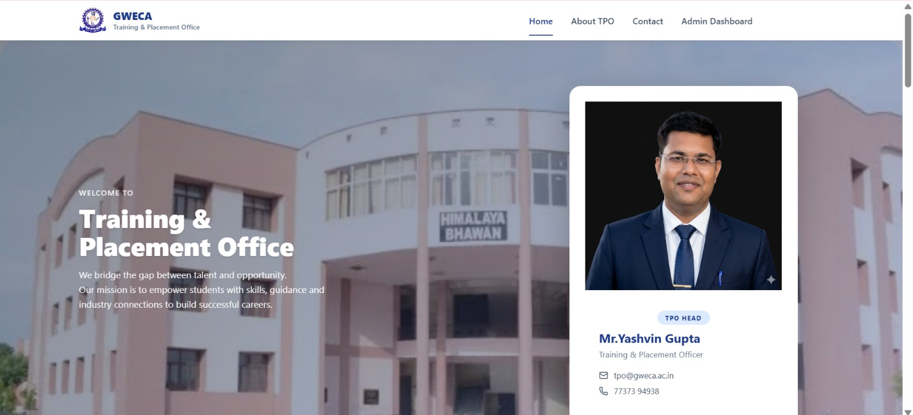
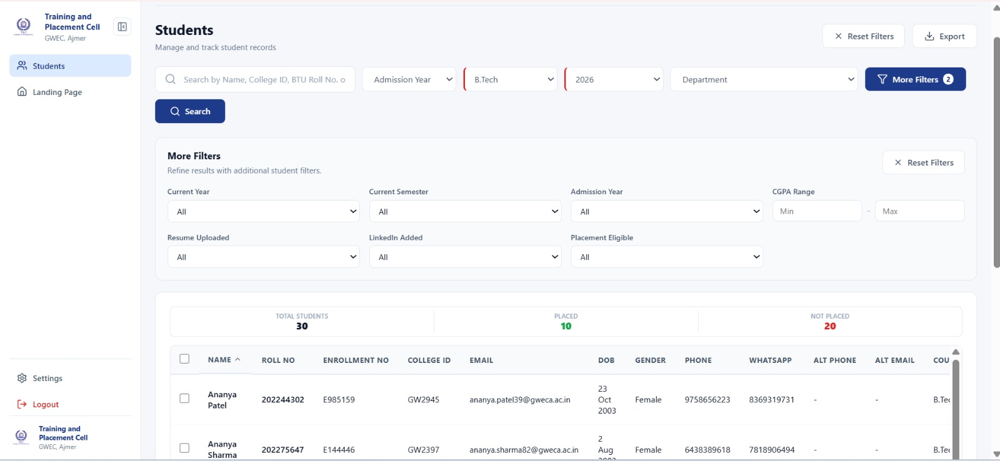
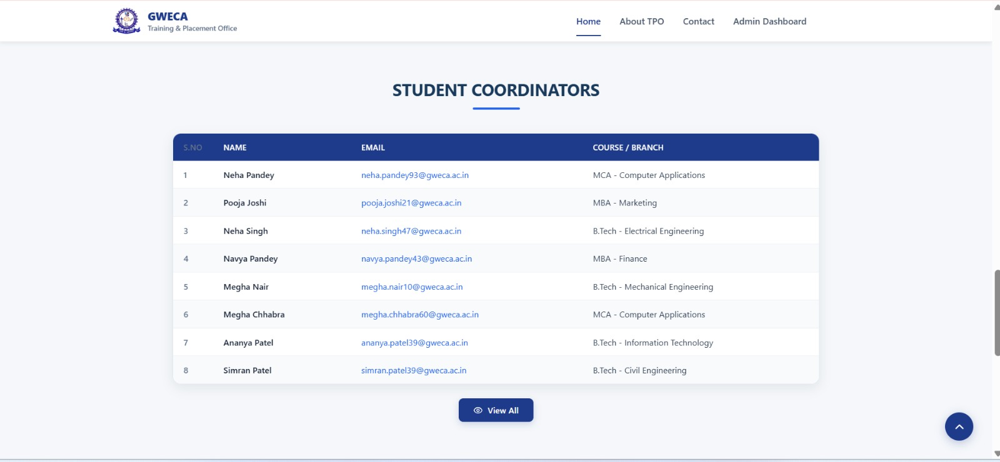
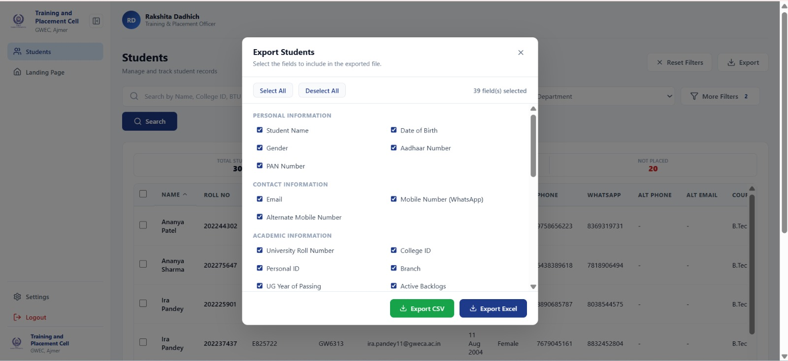
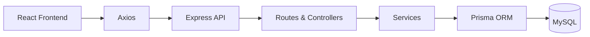

# TPO Portal — Training & Placement Management System

A web-based platform developed for Government Women’s Engineering College, Ajmer (GWEC) to streamline student data management, placement tracking, and administrative operations.

## Overview

TPO Portal provides a centralized system for students and the Training & Placement Office to manage placement-related activities efficiently.
## Screenshots

<p align="center">
  
  
</p>

<p align="center">
  
  
</p>

<p align="center">
  
</p>

## Features

**Student Portal**
- Secure registration with college email OTP verification and JWT authentication.
- Multi-step profile registration and academic record management.
- Resume link management and placement status tracking.
- Profile viewing and editing.

**Admin Portal**
- Student search, filtering, sorting, and pagination.
- Student profile verification and placement status management.
- Manual assignment and management of student and faculty coordinators.
- CSV and Excel export with customizable fields.
- College and TPO information management.
- Bulk student operations.

**Public Portal**
- College and TPO information.
- Faculty and student coordinator directory.
- Responsive interface with automatically refreshed coordinator information.

## Technology Stack

| Layer | Technologies |
|---|---|
| Frontend | React 19, Vite, React Router v7, Axios |
| Styling | Custom CSS |
| Backend | Node.js, Express.js 5 |
| Database & ORM | MySQL, Prisma 6 |
| Authentication | JWT, bcryptjs |
| Email & OTP | Nodemailer, Gmail SMTP |
| File Handling & Export | Multer, ExcelJS, CSV |

## Architecture



The application follows a layered architecture that separates frontend components, API routes, business logic, and database operations.

## Project Structure

```text
tpo-portal/
├── frontend/
│   └── src/
│       ├── pages/
│       ├── components/
│       ├── services/
│       └── utils/
├── backend/
│   ├── src/
│   │   ├── routes/
│   │   ├── controllers/
│   │   ├── services/
│   │   └── middleware/
│   └── prisma/
├── docs/
└── README.md
```

## Getting Started

**Prerequisites:** Node.js, npm, and MySQL.

1. Clone the repository:

   ```bash
   git clone <YOUR_REPOSITORY_URL>
   cd tpo-portal
   ```

2. Install frontend and backend dependencies:

   ```bash
   cd frontend && npm install
   cd ../backend && npm install
   ```

3. Configure the required environment variables for the database, JWT, email service, and API URL.

4. Run database migrations from the backend directory:

   ```bash
   npx prisma migrate dev
   ```

5. Start the frontend and backend using their configured npm scripts.

## Security

- Password hashing with bcryptjs.
- JWT-based authentication with token expiry.
- Role-based access control.
- OTP verification for email registration and password reset.
- Protected frontend routes and backend APIs.
- Input validation and file-upload handling.

## Contributors

- Ritu Saini
- Rakshita Dadhich

